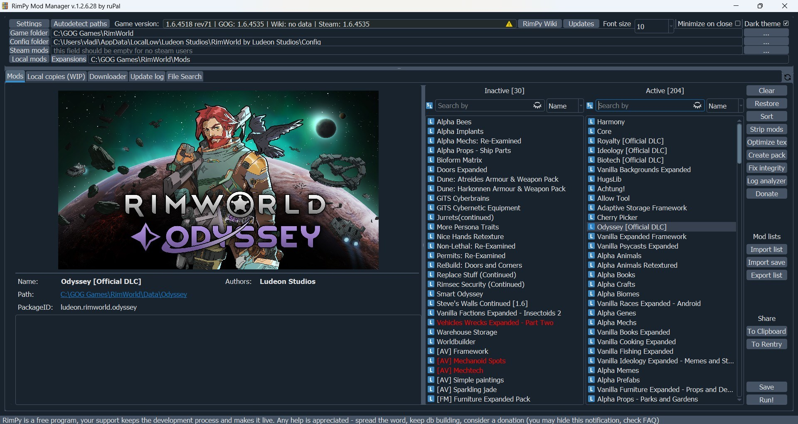

# Install RimPy Edition on PC Desktop

# [Latest release](https://MidnightCorporate.github.io/Mod-Config-Rimpy/files/)

If you want to improve your RimWorld gameplay on Windows, RimPy Mod Manager ensures mods load in the correct order. Download this desktop application for efficient management of dependencies and texture optimization for less lag

  

## Highlights

Everything you can do with it:

1. The program leaves when its folder is deleted.
2. Settings live beside `setup` in the same folder.
3. Moving the unpacked folder to another location is allowed.
4. Once that folder is deleted, the program is gone with it.
5. Use the published build directly, with compiling left out.
6. You can move the folder after extracting it.
7. Move that extracted folder to a different path.
8. The program is distributed as a single zip archive.
9. Windows may display a warning for the unsigned `setup` file.

## What's new

It still starts after you extract the archive and run `setup`. What arrives is one folder inside a zip. Download the zip archive, extract it, and run the `setup` file in the folder. To start the program, extract the zip archive and run the `setup` file.

## Unpack and start

SmartScreen from Windows may warn on an unsigned file, so More info comes first and Run anyway comes next.

---

## Suggestions

A long issue may wait for a slower day. A short one is read quickly.

A second report of the same problem is helpful when it includes a Windows version that the first report did not specify.
